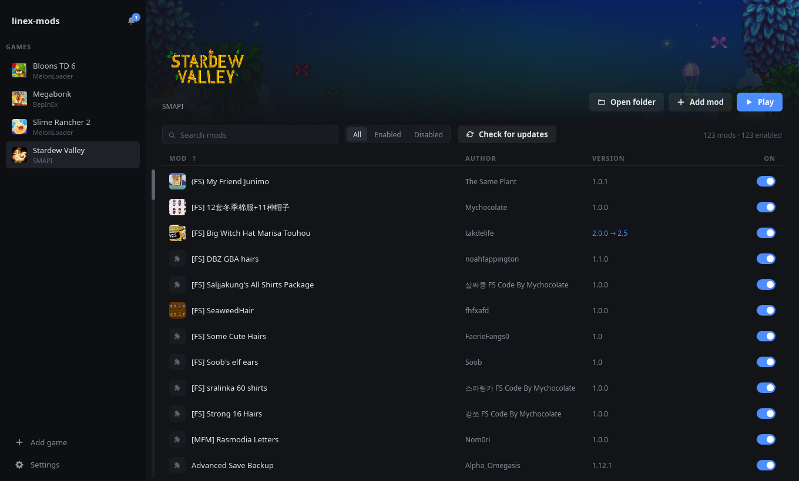
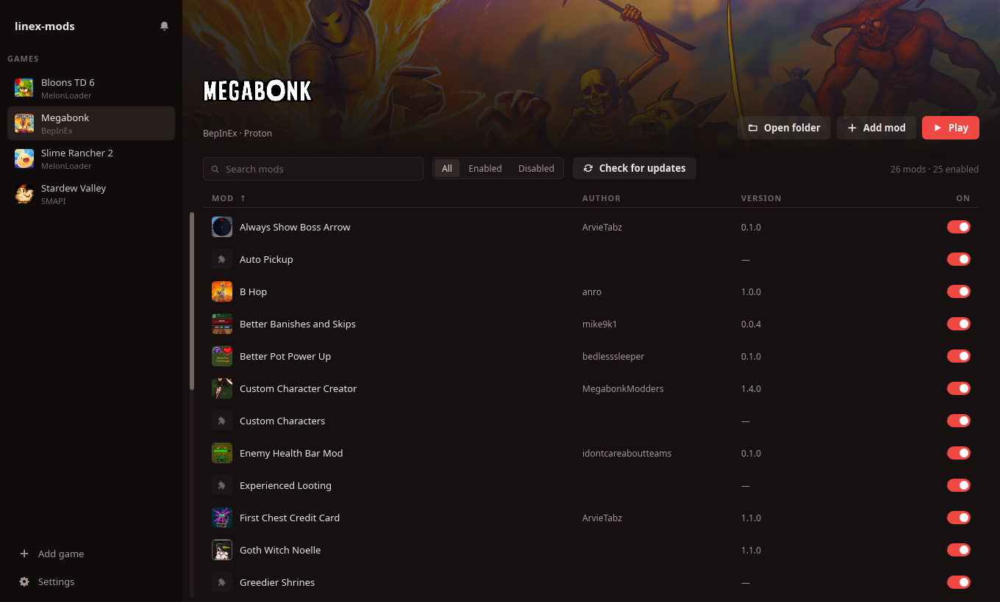

<div align="center">


# linex-mods

**A native Linux mod manager for Steam games.**<br>
Vibecoded, works like Vortex, exists because I'm lazy to mod on Linux.




</div>

## Why

Modding a Windows game on Linux means unzipping archives, guessing which folder each file
goes to, and then finding out Proton silently ignored the mod loader. linex-mods does the
boring part: it finds your Steam games, installs mods in the right place, keeps track of
what each mod put where, and tells you when something won't load.

It is a small native app (Rust + Slint): about 30 MB of RAM, no browser engine inside.

## Features

**Mods**
- Install from `.zip`, `.7z` or `.rar` with the **Add mod** button or by **dragging files**
  onto the window.
- The Nexus **"Mod Manager Download"** button opens straight in linex-mods (free accounts
  included).
- Turn mods on and off without deleting them; remove sends everything the mod installed to
  the trash, keeping shared libraries other mods still use.
- **Thunderstore** packages from the command line, with their dependencies, in r2modman's
  folder layout (`linex-mods ts install <game> Owner-Name`). A package zip downloaded by hand
  from thunderstore.io can also be dropped on the window.
- Reinstalling a SMAPI mod keeps its `config.json`.
- Right-click a mod: enable/disable, show in folder, open its page, properties, remove.

**Knowing what you have**
- Icons, names, versions and authors from SMAPI and Thunderstore manifests and from the Nexus.
- **Update check** for mods from the Nexus, including SMAPI mods matched through their
  `UpdateKeys`.
- Warns when a mod was built for a different loader (a MelonLoader mod in a BepInEx game).
- Warns when Proton will ignore the loader DLL and copies the launch option that fixes it.

**Loaders**
- Detects **SMAPI**, **MelonLoader** and **BepInEx**.
- Installs MelonLoader or BepInEx in Unity games with one click (BepInEx 5 for Mono games,
  BepInEx 6 bleeding edge for IL2CPP games).

**Looks**
- Dark and minimal, with the game art from your Steam library.
- Optional colors from your wallpaper (wallust or pywal palette), updated live.
- English and Brazilian Portuguese, following the system language.

<div align="center">

<br><sub>Wallpaper colors (wallust) on Megabonk with BepInEx mods.</sub>
</div>

## Supported games

Any Steam game (native or Flatpak Steam, every library folder) that has, or can get, one of:

| Loader | Games | Install from the app |
| --- | --- | --- |
| SMAPI | Stardew Valley | links to smapi.io |
| MelonLoader | Unity games (Mono and IL2CPP) | yes |
| BepInEx | Unity games (Mono and IL2CPP) | yes |

Games that run through Proton need the loader DLL to be loaded from the game folder
(`WINEDLLOVERRIDES="winhttp=n,b"` for BepInEx, `version=n,b` for MelonLoader). linex-mods
checks for it and gives you the exact launch option.

## Install

No releases yet, so build it:

```sh
git clone https://github.com/Valcones47/linex-mods
cd linex-mods
cargo build --release
./target/release/linex-mods
```

The first run adds linex-mods to your applications menu. To use the Nexus button, open
**Settings**, paste your API key (nexusmods.com → Settings → API Keys) and turn on
**website links**. The key is stored in the system keyring.

Optional: `7zip` or `libarchive` for `.7z`/`.rar` archives, `wl-copy` (or `xclip`) for
copying launch options.

## Command line

```
linex-mods                      open the window
linex-mods games                list games with a mod loader
linex-mods mods <game>          list a game's mods
linex-mods install <game> <file>...
linex-mods enable|disable|remove <game> <mod>
linex-mods unity                list Unity games without a loader
linex-mods loader <game> melonloader|bepinex
linex-mods updates <game>       check Nexus mods for new versions
linex-mods others               list Heroic and Lutris games (detection only for now)
linex-mods ts install <game> <package>
                                Thunderstore package + dependencies
                                (Owner-Name[-1.2.3], a thunderstore.io page or ror2mm:// link)
```

`<game>` is the Steam AppID or part of the name.

## Roadmap

- Thunderstore in the window: search and the "Install with Mod Manager" button.
- Nexus collections.
- Heroic and Lutris games: detection is done (`linex-mods others`); installing mods in them
  is next.

## Credits

[Amethyst Mod Manager](https://github.com/ChrisDKN/Amethyst-Mod-Manager) was a great
reference for how the Nexus links and loaders behave on Linux.

## License

GPL-3.0-or-later.
